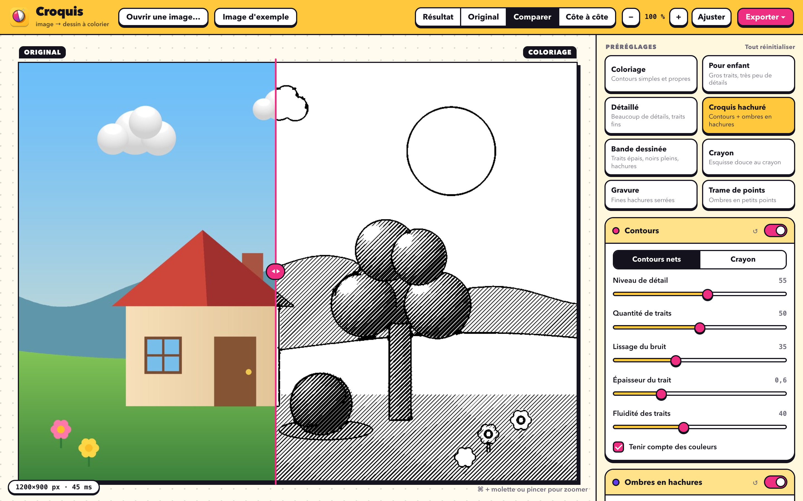
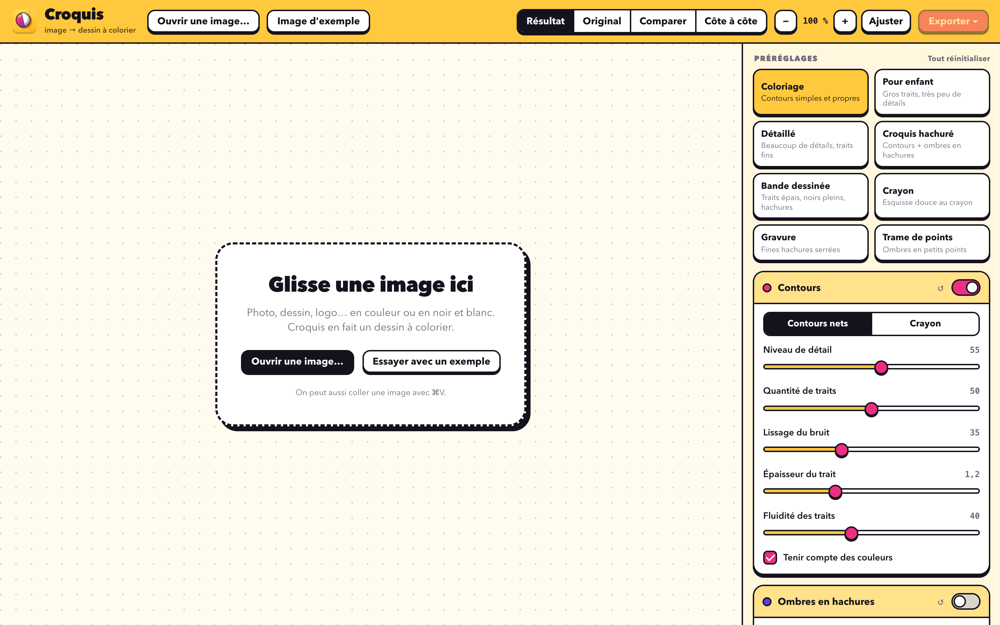
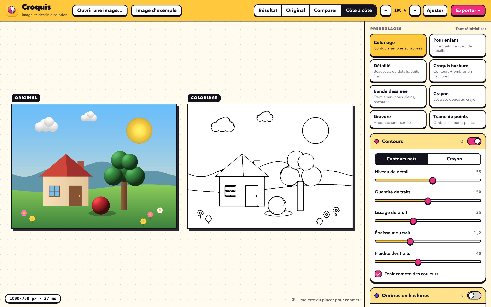
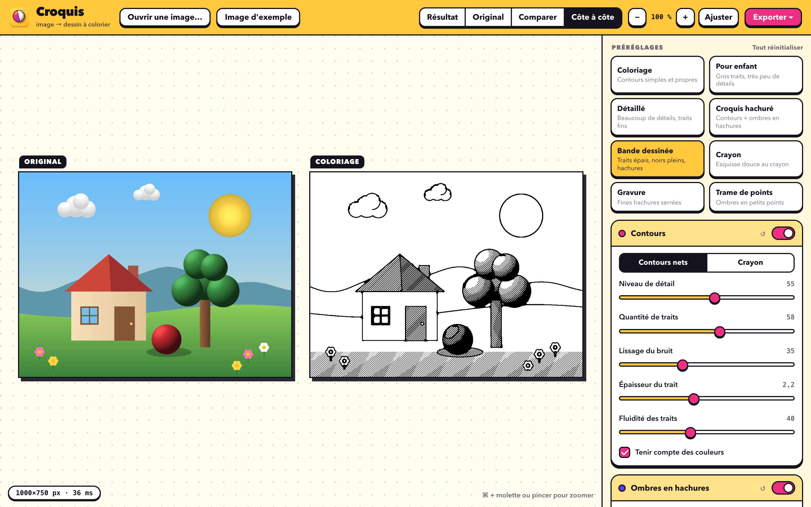
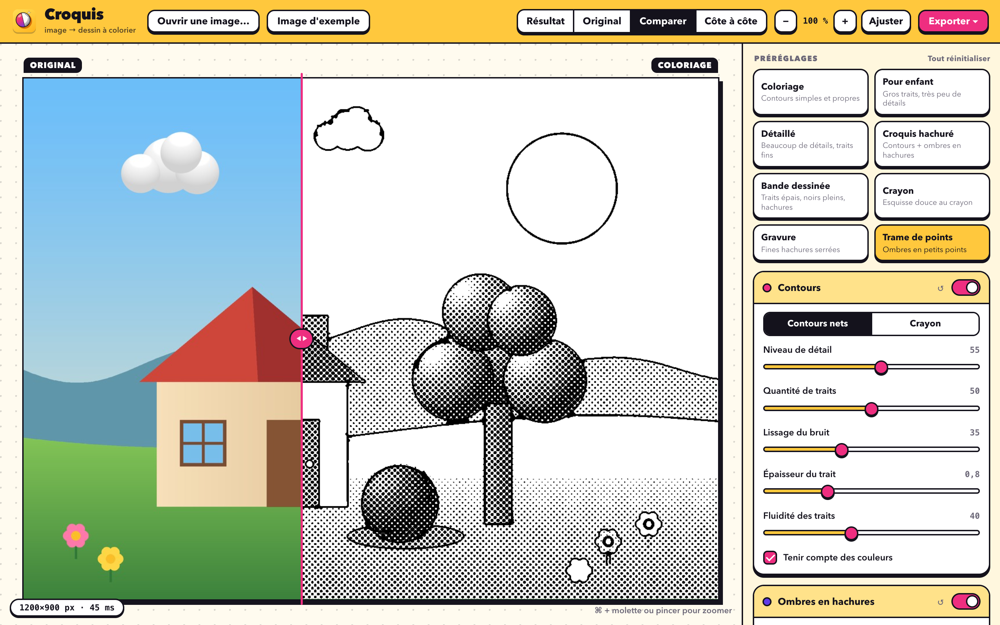
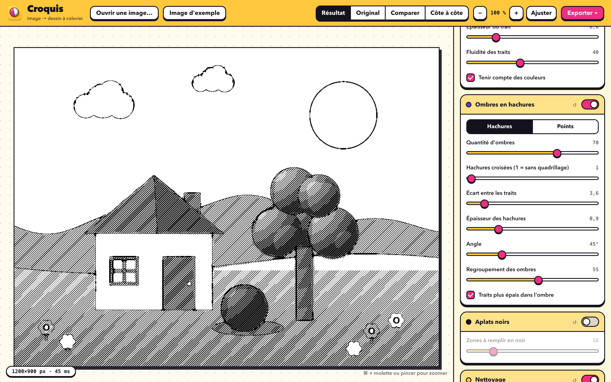

<div align="center">


# Croquis

**Turn any image into a coloring page.**
Black outlines, white background, shadows as hatching: every effect is an option, with a live preview.

[](LICENSE)


[**⬇ Download**](https://github.com/Wudstyz/Croquis/releases/latest) · [Français](README.md)



</div>

---

Croquis takes a photo, a drawing or a logo (in color or black and white) and turns it into a coloring page ready to print.
The app is **self-contained** (Python and libraries are inside): drag it to *Applications* and open it, nothing else to install.

> The interface is in French.

## What it does

| Option | Effect |
|---|---|
| **Outlines** | Black line around shapes. *Clean outlines* (coloring-book style) or *Pencil* (soft sketch). Smooth, continuous lines of even thickness. Settings: level of detail, amount of lines, noise smoothing, thickness, line fluidity, take colors into account. |
| **Shadows as hatching** | Dark areas become parallel hatching whose strokes get thicker with the shadow (so no grid pattern; crossed hatching is available as an option) or small dots. Settings: amount of shadow, spacing, thickness, angle, shadow grouping. |
| **Solid blacks** | Very dark areas (pupils, deep shadows) are filled with solid black. |
| **Cleanup** | Erases small specks and isolated strokes (photo grain, artifacts). |
| **Image and background** | **Pure black and white** (no gray at all: every dot is black or white, on by default), automatic contrast correction, transparent background (PNG), negative (white lines on black). |
| **Presets** | Coloriage, For kids, Detailed, Hatched sketch, Comic book, Pencil, Engraving, Dot pattern. |

Everything updates **live**: *Result*, *Original*, *Compare* (sliding divider) or *Side by side*, with zoom.
Lengths are relative to the image size, so the preview and the export give exactly the same drawing.

## Screenshots

<table>
<tr>
<td width="50%"><br><sub><b>Home</b>: drop an image, open it, paste it (⌘V) or try the sample.</sub></td>
<td width="50%"><br><sub><b>Side by side</b>: the "Coloriage" preset, simple clean outlines.</sub></td>
</tr>
<tr>
<td><br><sub><b>Comic book</b>: thick lines, solid blacks and hatching.</sub></td>
<td><br><sub><b>Dot pattern</b>: shadows as small dots, with the compare divider.</sub></td>
</tr>
<tr>
<td colspan="2"><br><sub><b>Settings</b>: each section can be switched on or off, and every slider acts live (here the "Engraving" preset).</sub></td>
</tr>
</table>

A full example is in [`examples/`](examples): the original image, its coloring page and its hatched version.

## Installation

1. Download `Croquis-1.1-macOS-arm64.dmg` from the [releases page](https://github.com/Wudstyz/Croquis/releases/latest), open it and drag **Croquis** into **Applications**.
2. **First launch**: the app is ad-hoc signed (no paid Apple developer account, so no notarization). macOS asks for a one-time confirmation:
   - **right-click Croquis → Open → Open**, or
   - in Terminal: `xattr -dr com.apple.quarantine /Applications/Croquis.app`

Requirements: an Apple Silicon Mac (M1 or later) running macOS 14 or later (value computed from the bundled components).

## Getting started

1. Open an image: **Ouvrir une image…** button (⌘O), drag and drop into the window, or paste with ⌘V. The **Image d'exemple** button lets you try without any file. Common formats are supported (PNG, JPEG, HEIC, TIFF, GIF, WebP, BMP).
2. Pick a preset, then tweak the sliders (double-click a slider to reset it).
3. **Export**: PNG (⌘S) or print-ready A4 PDF (⇧⌘S), at original size or in high-definition A4 (3508 px, sharp when printed at 300 dpi). You can also copy the image.

Shortcuts: `1` `2` `3` `4` switch views, `+` `−` `0` zoom, ⌘ + scroll or pinch also zoom.

## Known limitations

- A very busy photo (foliage, crowds) produces many lines: lower "Niveau de détail" and raise "Nettoyage" or "Lissage du bruit".
- Outlines stay open in places: Croquis does not guarantee perfectly closed regions for bucket-fill coloring.
- No opening by dropping on the Dock icon or via Finder's "Open With": use the Open button, drag and drop into the window, or paste.
- Export size is limited to 4500 px on the long side in "original size" mode (to keep memory reasonable).
- Tested only on an Apple Silicon Mac running macOS 26 (launched without Homebrew using `sandbox-exec`). Not tested on macOS 14 or 15, nor on another Mac. The native Open/Save dialogs were not verified automatically.

## Build from source

You need the Xcode command-line tools (`clang`, `codesign`, `hdiutil`). The script downloads a standalone Python once ([python-build-standalone](https://github.com/astral-sh/python-build-standalone), SHA-256 verified) and installs the libraries with pip.

```bash
./build_app.sh     # builds Croquis.app (≈ 115 MB)
./make_dmg.sh      # builds dist/Croquis-1.1-macOS-arm64.dmg and prints its SHA-256
```

Run without building (with a Python 3.14 that has `pywebview pillow numpy scipy pyobjc-framework-Cocoa`): `python app.py`.
Tests: `python -m unittest discover -s tests`.

## Code layout

| File | Role |
|---|---|
| `engine.py` | The engine: outlines, cleanup, hatching, solid fills, PNG/PDF export (numpy + scipy.ndimage + Pillow). |
| `app.py` | Native window (pywebview) and small local HTTP server (reserved to the app's own window). |
| `index.html` | The interface (preview, settings, zoom). |
| `sample.py` | The sample image, drawn by the program itself. |
| `make_icon.py` | Generates the icon (`icon.icns`, `docs/icon.png`). |
| `launcher.c`, `build_app.sh`, `make_dmg.sh` | Packaging as a self-contained Mac app. |
| `tests/` | Engine and server tests. |

## Contributing

Ideas and fixes are welcome: open an *issue* to discuss, or a *pull request* (run the tests first: `python -m unittest discover -s tests`).

## Privacy

Everything happens on your Mac: no image is sent over the Internet. Only your settings are stored, in `~/Library/Application Support/Croquis/`.

## License

[MIT](LICENSE). Third-party components: see [THIRD_PARTY_NOTICES.md](THIRD_PARTY_NOTICES.md).
