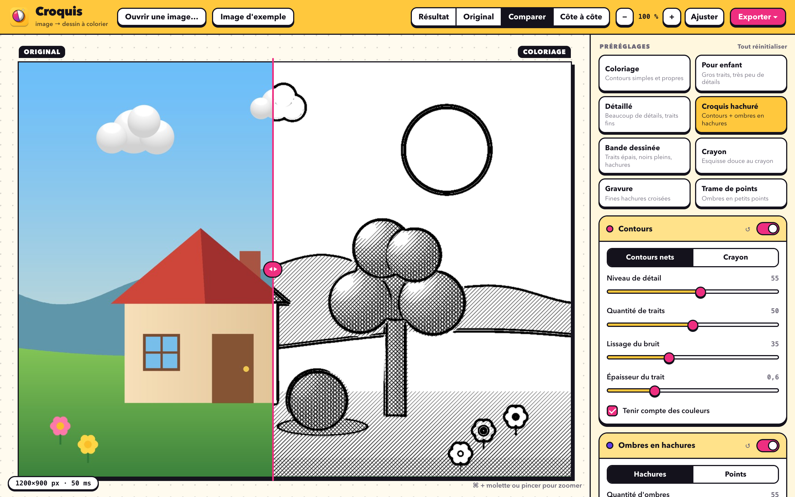
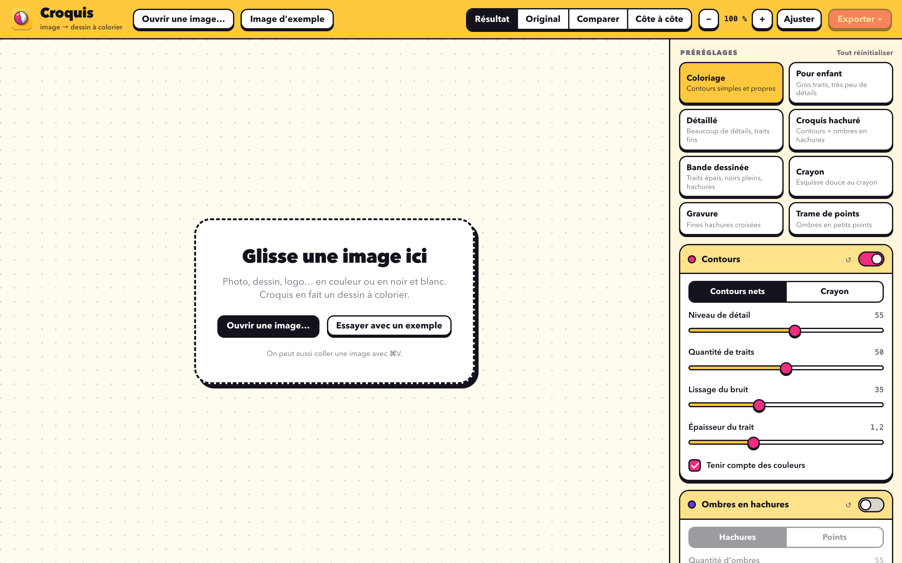
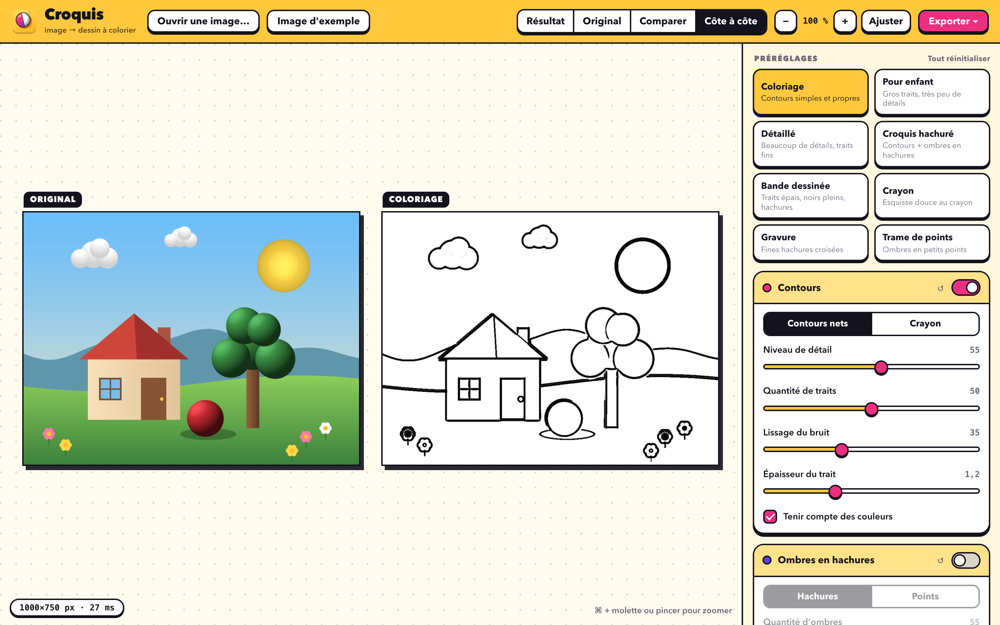
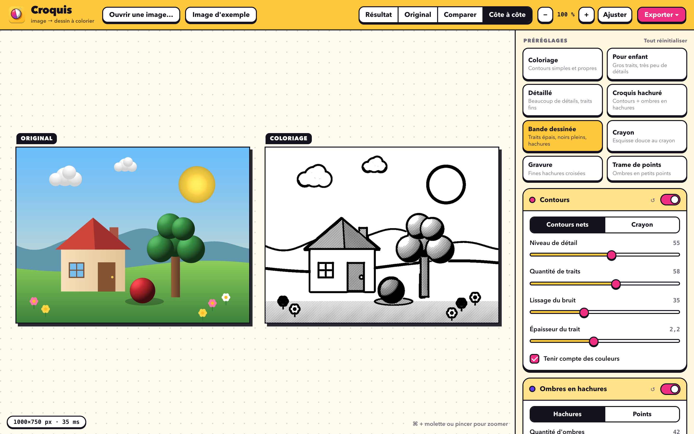
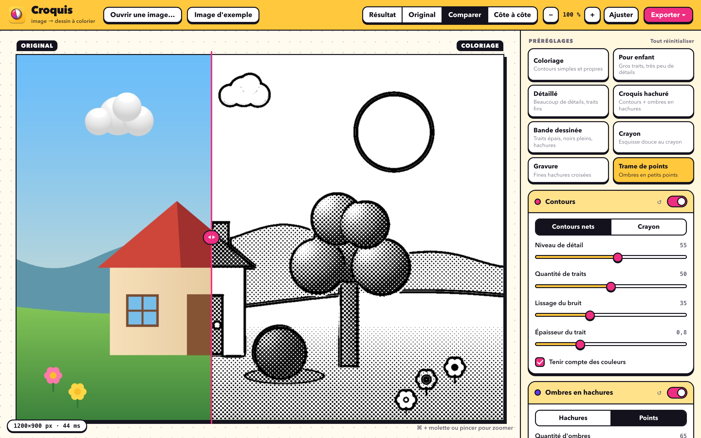
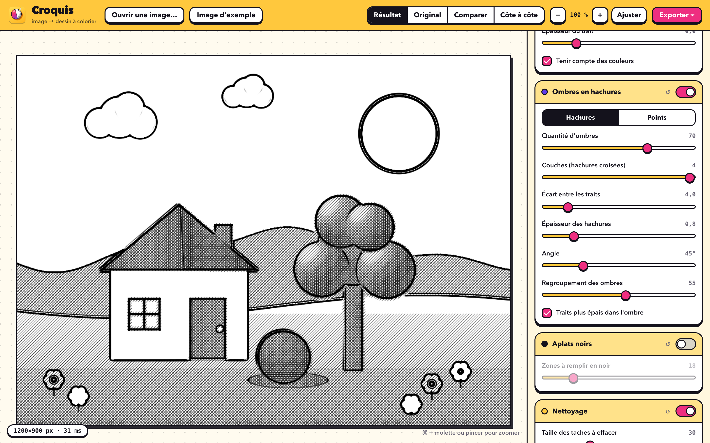

<div align="center">


# Croquis

**Transforme n'importe quelle image en dessin à colorier.**
Contours noirs, fond blanc, ombres en hachures : chaque effet est une option, avec un aperçu en direct.

[](LICENSE)


[**⬇ Télécharger**](https://github.com/Wudstyz/Croquis/releases/latest) · [English](README.en.md)



</div>

---

Croquis prend une photo, un dessin ou un logo (en couleur ou en noir et blanc) et en fait une page de coloriage prête à imprimer.
L'app est **autonome** (Python et bibliothèques sont dedans) : on la glisse dans *Applications* et on l'ouvre, sans rien installer d'autre.

## Ce que ça fait

| Option | Effet |
|---|---|
| **Contours** | Trait noir autour des formes. *Contours nets* (style coloriage) ou *Crayon* (esquisse douce). Réglages : niveau de détail, quantité de traits, lissage du bruit, épaisseur, prise en compte des couleurs. |
| **Ombres en hachures** | Les zones sombres deviennent des hachures (jusqu'à 4 couches croisées : plus l'ombre est profonde, plus il y en a) ou des petits points. Réglages : quantité d'ombres, écart, épaisseur, angle, regroupement des ombres. |
| **Aplats noirs** | Les zones très sombres (pupilles, ombres profondes) sont remplies en noir. |
| **Nettoyage** | Efface les petits points et traits isolés (grain d'une photo, parasites). |
| **Image et fond** | Correction automatique du contraste, fond transparent (PNG), négatif (traits blancs sur noir). |
| **Préréglages** | Coloriage, Pour enfant, Détaillé, Croquis hachuré, Bande dessinée, Crayon, Gravure, Trame de points. |

Tout se voit **en temps réel** : *Résultat*, *Original*, *Comparer* (curseur glissant) ou *Côte à côte*, avec zoom.
Les longueurs sont relatives à la taille de l'image : l'aperçu et l'export donnent exactement le même dessin.

## Captures d'écran

<table>
<tr>
<td width="50%"><br><sub><b>Accueil</b> : glisser une image, l'ouvrir, la coller (⌘V) ou essayer l'exemple.</sub></td>
<td width="50%"><br><sub><b>Côte à côte</b> : le préréglage « Coloriage », contours simples et propres.</sub></td>
</tr>
<tr>
<td><br><sub><b>Bande dessinée</b> : traits épais, aplats noirs et hachures.</sub></td>
<td><br><sub><b>Trame de points</b> : les ombres en petits points, avec le curseur de comparaison.</sub></td>
</tr>
<tr>
<td colspan="2"><br><sub><b>Réglages</b> : chaque section s'active ou se désactive, et chaque curseur agit en direct (ici le préréglage « Gravure »).</sub></td>
</tr>
</table>

Un exemple complet est dans [`examples/`](examples) : l'image d'origine, son coloriage et sa version hachurée.

## Installation

1. Télécharger `Croquis-1.0-macOS-arm64.dmg` depuis la [page des versions](https://github.com/Wudstyz/Croquis/releases/latest), l'ouvrir, puis glisser **Croquis** dans **Applications**.
2. **Première ouverture** : l'app est signée « ad hoc » (pas de compte développeur Apple payant, donc pas de notarisation). macOS demande une confirmation une seule fois :
   - **clic droit sur Croquis → Ouvrir → Ouvrir**, ou
   - dans le Terminal : `xattr -dr com.apple.quarantine /Applications/Croquis.app`

Prérequis : un Mac Apple Silicon (M1 ou plus récent) sous macOS 14 ou plus (valeur calculée d'après les composants embarqués).

## Premiers pas

1. Ouvrir une image : bouton **Ouvrir une image…** (⌘O), glisser-déposer dans la fenêtre, ou coller avec ⌘V. Le bouton **Image d'exemple** permet d'essayer sans fichier. Les formats courants sont lus (PNG, JPEG, HEIC, TIFF, GIF, WebP, BMP).
2. Choisir un préréglage, puis ajuster les curseurs (double-clic sur un curseur : valeur par défaut).
3. **Exporter** : PNG (⌘S) ou PDF A4 prêt à imprimer (⇧⌘S), à la taille d'origine ou en A4 haute définition (3508 px, impression nette à 300 dpi). On peut aussi copier l'image.

Raccourcis : `1` `2` `3` `4` changent de vue, `+` `−` `0` zooment, ⌘ + molette ou pincement zooment aussi.

## Limites connues

- Une photo très chargée (feuillage, foule) donne beaucoup de traits : baisser « Niveau de détail » et monter « Nettoyage » ou « Lissage du bruit ».
- Les contours restent ouverts par endroits : Croquis ne garantit pas des zones parfaitement fermées pour un remplissage au pot de peinture.
- Pas d'ouverture par « glisser sur l'icône du Dock » ni par « Ouvrir avec » du Finder : utiliser le bouton Ouvrir, le glisser-déposer dans la fenêtre ou le collage.
- Taille d'export limitée à 4500 px de côté en « taille d'origine » (pour garder une mémoire raisonnable).
- Testé uniquement sur un Mac Apple Silicon sous macOS 26 (lancement sans Homebrew via `sandbox-exec`). Non testé sur macOS 14 ou 15, ni sur un autre Mac. Les boîtes de dialogue natives Ouvrir/Enregistrer n'ont pas été vérifiées automatiquement.

## Construire depuis les sources

Il faut les outils en ligne de commande de Xcode (`clang`, `codesign`, `hdiutil`). Le script télécharge une fois Python autonome ([python-build-standalone](https://github.com/astral-sh/python-build-standalone), vérifié par SHA-256) et installe les bibliothèques avec pip.

```bash
./build_app.sh     # fabrique Croquis.app (≈ 115 Mo)
./make_dmg.sh      # fabrique dist/Croquis-1.0-macOS-arm64.dmg et affiche sa somme SHA-256
```

Lancer sans construire (avec un Python 3.14 qui a `pywebview pillow numpy scipy pyobjc-framework-Cocoa`) : `python app.py`.
Tests : `python -m unittest discover -s tests`.

## Organisation du code

| Fichier | Rôle |
|---|---|
| `engine.py` | Le moteur : contours, nettoyage, hachures, aplats, export PNG/PDF (numpy + scipy.ndimage + Pillow). |
| `app.py` | Fenêtre native (pywebview) et petit serveur HTTP local (réservé à la fenêtre de l'app). |
| `index.html` | L'interface (aperçu, réglages, zoom). |
| `sample.py` | L'image d'exemple, dessinée par le programme. |
| `make_icon.py` | Génère l'icône (`icon.icns`, `docs/icon.png`). |
| `launcher.c`, `build_app.sh`, `make_dmg.sh` | Empaquetage en app Mac autonome. |
| `tests/` | Tests du moteur et du serveur. |

## Contribuer

Les idées et les corrections sont les bienvenues : ouvre une *issue* pour en parler, ou une *pull request* (lance les tests avant : `python -m unittest discover -s tests`).

## Vie privée

Tout se passe sur ton Mac : aucune image n'est envoyée sur Internet. Seuls les réglages sont enregistrés, dans `~/Library/Application Support/Croquis/`.

## Licence

[MIT](LICENSE). Composants tiers : voir [THIRD_PARTY_NOTICES.md](THIRD_PARTY_NOTICES.md).
